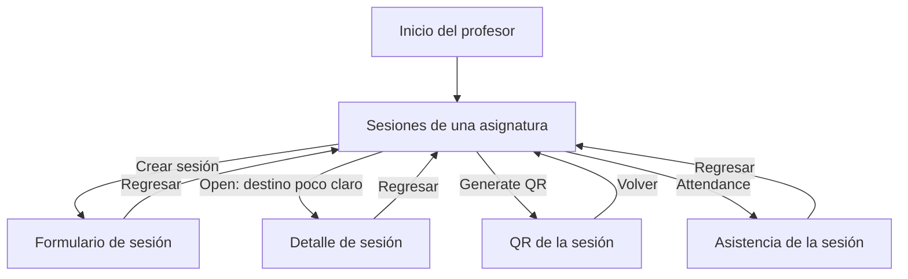

# CP1 — Auditoría UX del flujo del profesor

## Alcance y evidencia

Pantallas seleccionadas: lista de sesiones de una asignatura y
visualización del QR de una sesión.

Se revisan los wireframes de baja fidelidad documentados en
02-code-and-ui/wireframes/README.md del repositorio att-check-docs.
No representan pantallas móviles implementadas. La app del taller
todavía conserva el starter del curso.

Elementos del dominio: profesor, asignatura, sesión de clase y QR.

## Referencias antes de los cambios

## Hallazgos

| Pantalla | Problema observado en el diseño | Principio | Severidad | Arreglo propuesto |
|---|---|---|---|---|
| Sesiones | No se representa el estado mientras se consultan las sesiones. | Visibilidad del estado | Alta | Mostrar skeletons con fecha y acciones de cada fila. |
| Sesiones | No se especifica qué aparece si falla la consulta. | Recuperación de errores | Alta | Mostrar un mensaje y un botón Reintentar. |
| Sesiones | No se representa una asignatura sin sesiones. | Orientación al usuario | Media | Mostrar un mensaje y la acción Crear sesión. |
| Sesiones | La acción Open no explica qué información abre. | Claridad de etiquetas | Media | Usar Ver sesión y conservar la fecha como contexto. |
| Sesiones | Las filas presentan acciones diferentes sin explicar el criterio. | Consistencia | Media | Definir las acciones según el estado de la sesión y mostrar ese estado. |
| QR | El texto Valid for 15 minutes no indica cuánto tiempo queda. | Visibilidad del estado | Alta | Mostrar la hora de vencimiento y el tiempo restante. |
| QR | No se representa el estado de QR vencido. | Prevención de errores | Alta | Identificar el vencimiento con texto y ofrecer generar otro QR. |
| QR | No se especifica retroalimentación al generar o renovar el QR. | Retroalimentación | Alta | Mostrar progreso, deshabilitar envíos repetidos y comunicar éxito o error. |

## Navegación documentada

El siguiente mapa interpreta las acciones de los wireframes;
no describe navegación ya ejecutable en el starter.

El usuario puede perder orientación al elegir Open, porque la
etiqueta no aclara el destino. También falta explicar por qué
unas sesiones ofrecen Generate QR y otras Attendance.

## Verificaciones pendientes

El wireframe de texto no permite medir contraste, tamaño táctil
ni comportamiento responsivo. Estas propiedades se comprobarán
sobre la implementación; no se reportan como fallos medidos.