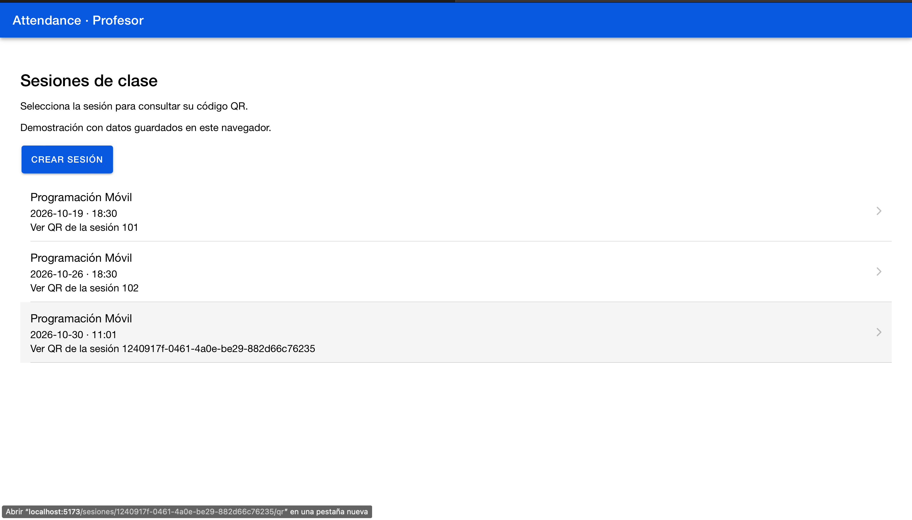
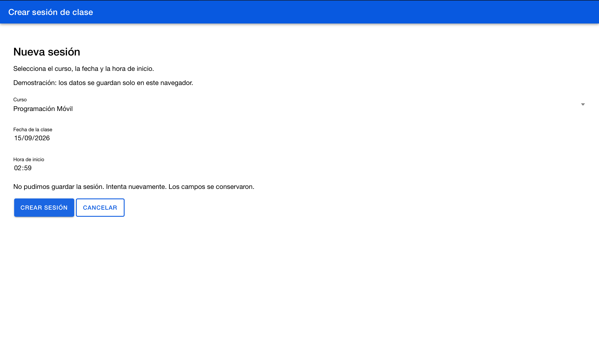

# CP6 — Class session form

## Scope

The professor opens `/sesiones/nueva` from the session list.
Fields follow the team's POST `/api/classes` contract.

The prototype saves data in localStorage.
Programación Móvil and courseId 1 are demonstration data.
Backend integration and course ownership checks remain pending.

## Validation rules

| Field | Rule | Domain purpose |
| --- | --- | --- |
| Course | Select the available course | Associate the class session with a course |
| Date | Required, valid calendar date | Identify the day of the class |
| Start time | Required, valid HH:mm time | Identify when the class begins |

The submit button is disabled while fields are invalid or saving.

## Feedback

- Field validation messages appear below each field.
- A spinner and saving text appear during submission.
- A success toast confirms creation before returning to the list.
- Saving errors preserve entered values.
- An alert requests confirmation before discarding the form.

## Validation results

- Production build: passed.
- Existing session list retry test: 1 passed.
- Manual field validation and disabled submit: passed.
- Cancellation alert and continue editing: passed.
- Successful creation and list update: passed.
- Persistence after page reload: passed.
- Simulated saving failure with preserved values: passed.

The existing automated test covers the list, not the form.

## Reproducing a saving failure

Open `/sesiones/nueva?estado=error`, complete the fields and submit.
This simulates a failure locally without contacting a server.

## Screenshots

