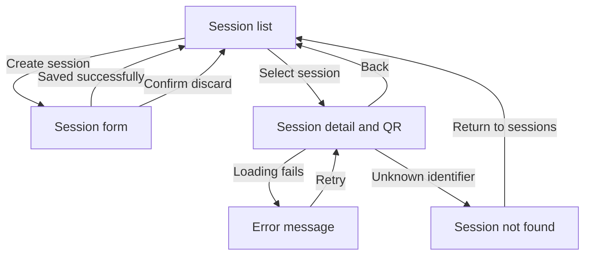
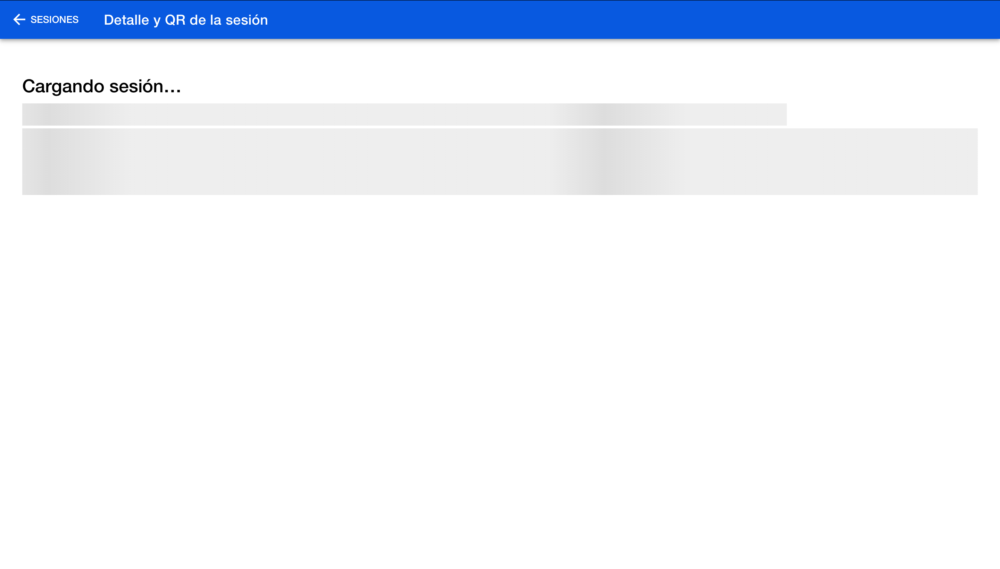
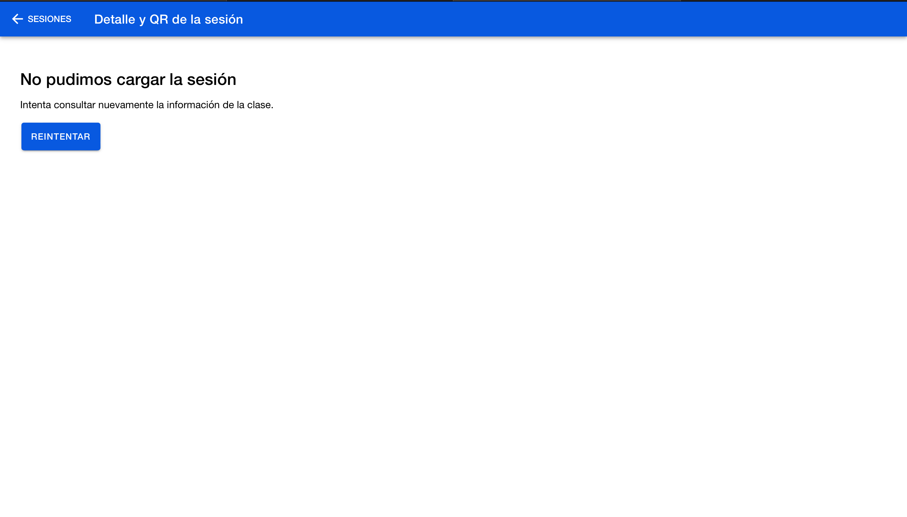
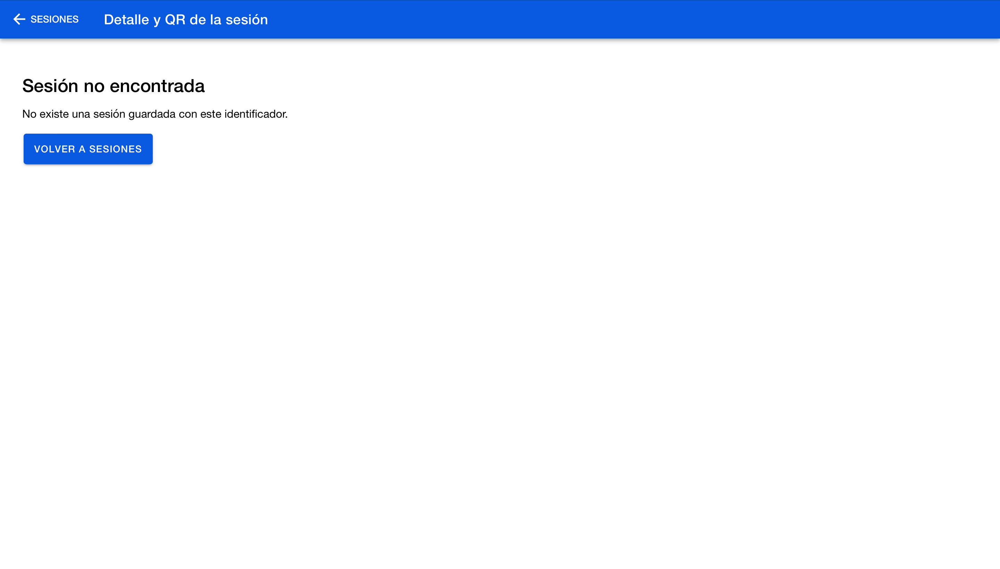

# CP7 — Session detail and navigation flow

## Implemented routes

| Route | Purpose |
| --- | --- |
| `/sesiones` | List class sessions |
| `/sesiones/nueva` | Create a class session |
| `/sesiones/:id/qr` | Display session details and QR integration status |

The detail page reads the session identifier from the route.
Data comes from localStorage. QR generation remains pending backend integration.

## Navigation map

## Comparison with CP1

The CP1 map described wireframe actions, including an ambiguous Open label.
The prototype now connects the session list, creation form and detail page.

Selecting a list row opens the corresponding session directly.
After creation, the app returns automatically to the updated list.
Retry allows recovery without returning to the list first.

The number of steps saved has not been measured.
Attendance review and QR generation from the original map remain outside
the implemented prototype.

## Detail states

- Loading: skeletons and a loading message.
- Ready: course, session identifier, date and start time.
- Error: explanatory message and Retry button.
- Not found: unknown identifier with a return action.

## Reproducing the states

- `/sesiones/101/qr`: loading followed by session details.
- `/sesiones/101/qr?estado=error`: simulated error; Retry loads the details.
- `/sesiones/no-existe/qr`: session not found.

## Evidence

## Technical validation

- Production build: passed.
- Existing session list retry test: 1 passed.
- The existing automated test does not cover the detail page.
