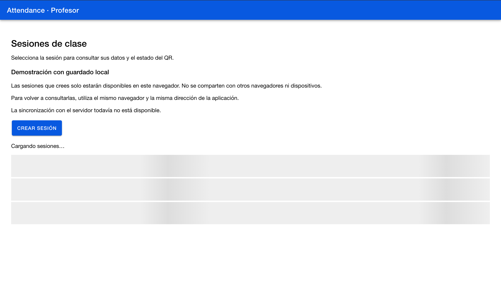

# CP8 — Usability test

## Participants and method

Two real participants tested the Attendance professor prototype.
P1 used Safari and P2 used Chrome.

Each participant completed three tasks.
The approximate total time was five minutes per participant.
Individual task times and assistance were not recorded separately.

## Tasks

1. Create a class session for Programación Móvil.
2. Open the created session, check its details and return to the list.
3. Start another session form and cancel, discarding the changes.

## Results

| Participant | Task | Completed | Task time | Reported difficulty |
| --- | --- | --- | --- | --- |
| P1 — Safari | Create session | Yes | Not measured separately | Creation described as easy |
| P1 — Safari | View details | Yes | Not measured separately | None reported |
| P1 — Safari | Cancel creation | Yes | Not measured separately | None reported |
| P2 — Chrome | Create session | Yes | Not measured separately | Creation described as easy |
| P2 — Chrome | View details | Yes | Not measured separately | None reported |
| P2 — Chrome | Cancel creation | Yes | Not measured separately | None reported |

## Main finding

The comparison between browsers caused confusion: sessions created
in Safari did not appear in Chrome.

The prototype stores sessions in localStorage, which is separate
for each browser and origin. This observation does not establish
that sessions were deleted or overwritten.

## Proposed correction

Make the session list explicitly explain that sessions are stored
only in the current browser and are not shared with other browsers
or devices.

Shared sessions require future backend integration.

## Limitations

Only one usability issue was reported, rather than the three
requested by the workshop.
The approximate five-minute duration covers all tasks per participant.
No individual task timings were collected.

## Correction status

The interface correction and its verification are pending.

## Implemented correction

The session list now explicitly explains that created sessions are
available only in the current browser and application address.
It also states that sessions are not shared across browsers or devices
and that server synchronization is not available.

This replaces the pending implementation status above.
The change clarifies storage behavior; it does not add synchronization.

## Verification

- Production build: passed.
- Existing session list retry test: 1 passed.
- Screenshot captured by the student.
- Participant comprehension after the change: not yet verified.

