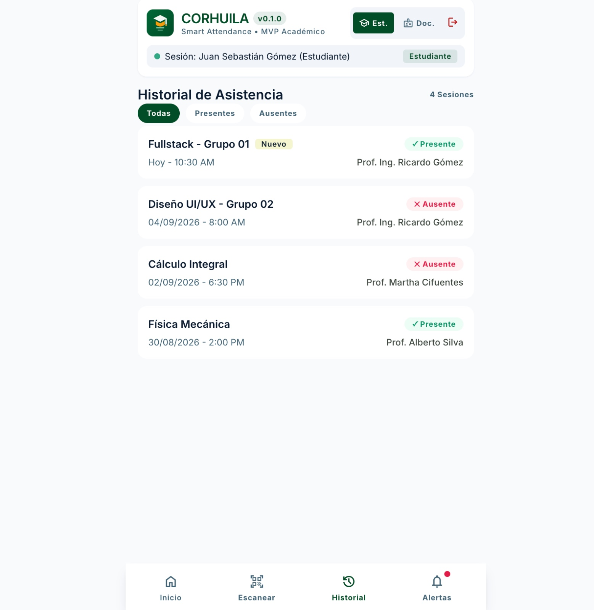
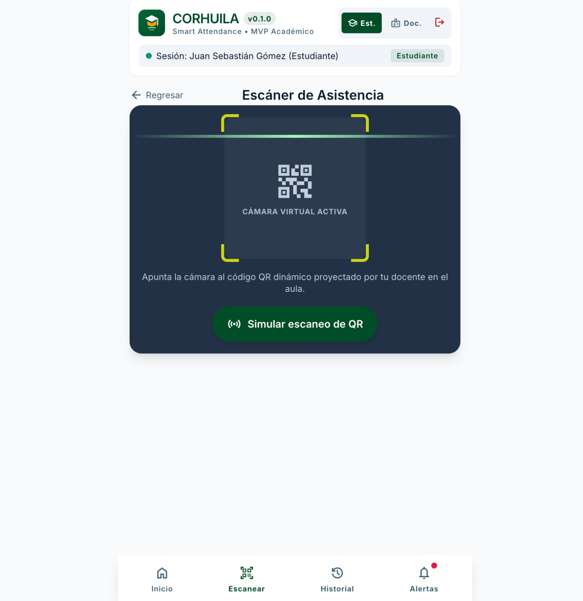
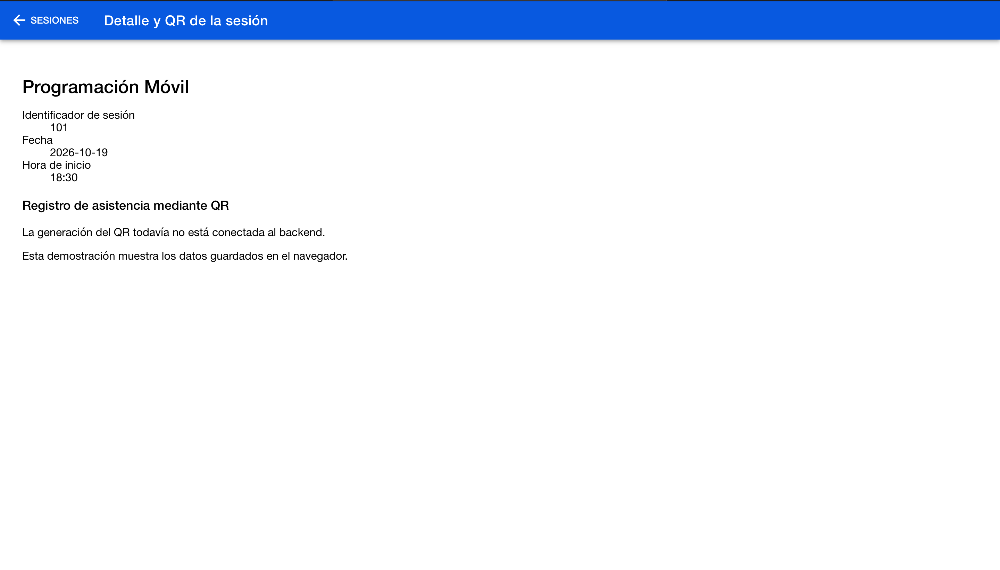
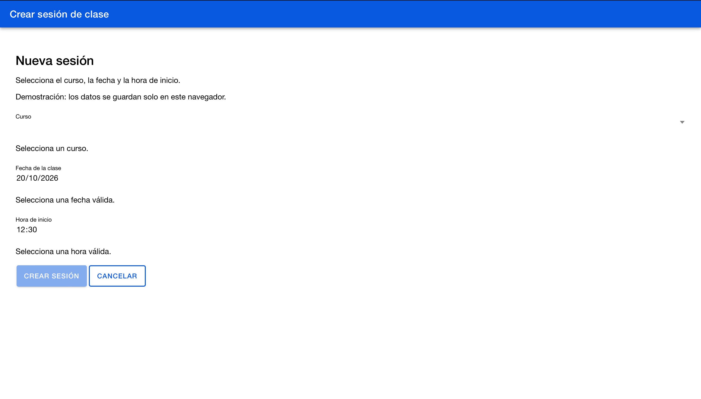
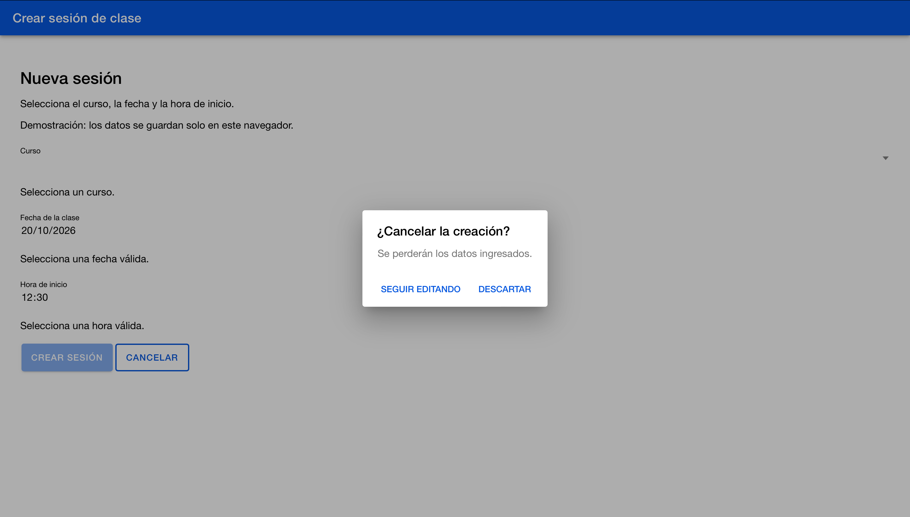

# CP9 — Before and after, and team backlog

## Comparison scope

The before images are the original documented wireframes reviewed in CP1.
The after images show the implemented workshop prototype.
This comparison does not represent a production app migration.

## Screens

| Screen | Before | After |
| --- | --- | --- |
| Professor session list |  |  |
| Session detail and QR |  |  |

### Professor session list

The prototype connects the list to session creation and detail navigation.
Loading, error, retry and empty states communicate what is happening.
The storage notice clarifies that created sessions remain in the current browser.

Principles: visibility of system status, error recovery and clear expectations.

### Session detail and QR

The detail page identifies the selected session through its route parameter
and displays the course, date and start time.
Loading, retry and not-found states replace an unexplained blank screen.

Principles: orientation, consistent navigation and error recovery.
QR generation remains pending backend integration.

## Additional form evidence

The creation form provides field validation, submission progress,
success feedback and confirmation before discarding changes.
No original form screenshot was captured, so no visual before comparison
is claimed for this screen.

## Team backlog stories

### US1 — Create a class session with reliable feedback

As a professor, I want to create a session for one of my courses
so that I can prepare attendance registration.

Acceptance criteria:
- The form requires a course, valid date and valid start time.
- Submission is disabled while invalid or already saving.
- The request follows the POST `/api/classes` contract.
- A successful response displays confirmation and updates the session list.
- A failed request preserves the fields and displays an explanatory message.
- Discarding entered data requires confirmation.
- The backend verifies that the professor owns the selected course.

### US2 — Consult a session and recover from loading errors

As a professor, I want to open a specific session from my list
so that I can verify its information before managing attendance.

Acceptance criteria:
- Selecting a session passes its identifier through the route.
- The detail displays the matching course, date and start time.
- Loading displays an accessible progress message.
- A failed load displays a Retry action that requests the data again.
- An unknown identifier displays a not-found message and return action.
- The professor can return to the session list.

### US3 — Access saved sessions across browsers

As a professor, I want my sessions stored in the team backend
so that I can consult them from different browsers or devices.

Acceptance criteria:
- Created sessions are persisted in the backend.
- After signing in as the same professor in another browser,
  the session list includes previously saved sessions.
- Session access respects authentication and course ownership.
- Server failures display a clear message with a retry action.
- Until backend integration is available, the prototype clearly
  identifies its browser-local storage limitation.

## Remaining limitations

- The prototype stores sessions locally.
- QR generation and attendance review are not implemented.
- The usability test reported one issue, rather than the three requested.
- Comprehension of the revised storage notice has not been retested.
