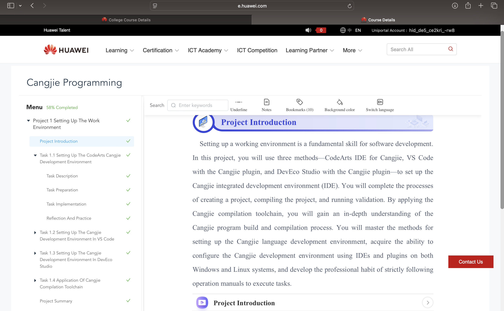
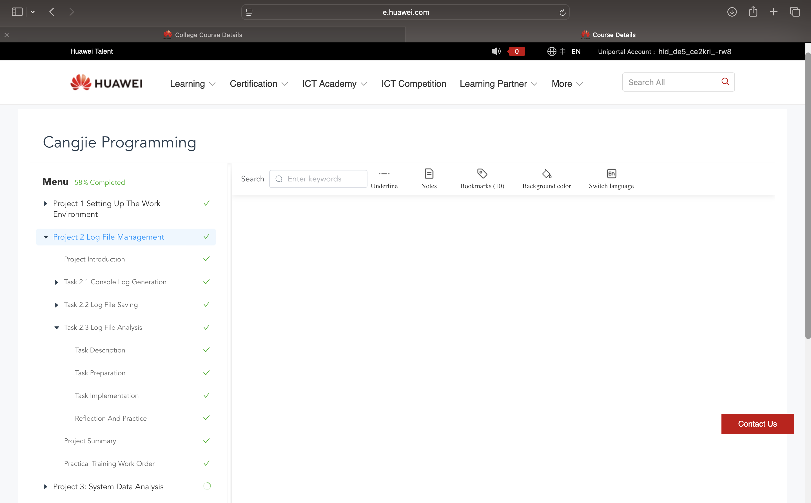
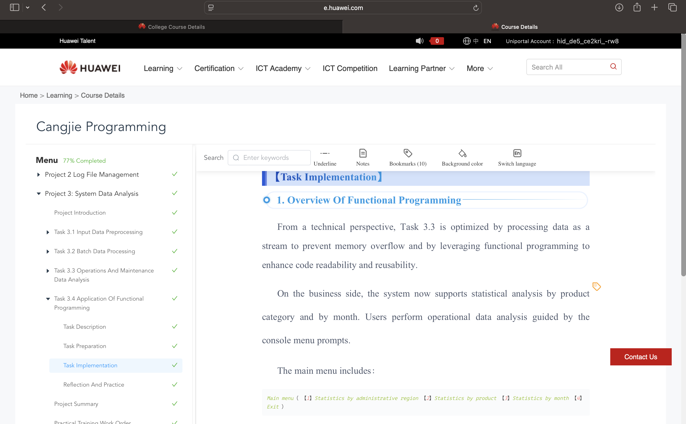
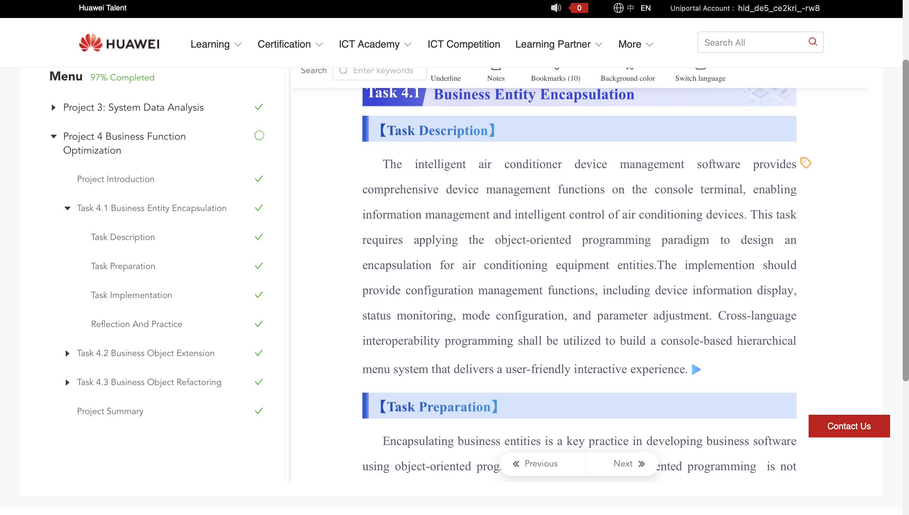
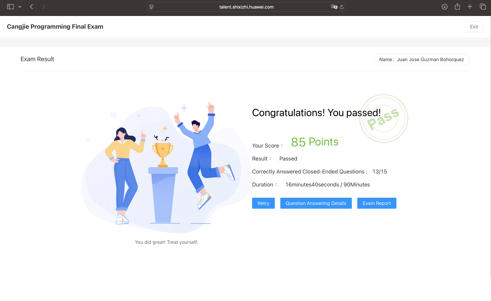

# Certificación C3 — Programación Móvil

## 1. Ficha del estudiante y del curso

| Dato | Información |
|---|---|
| Nombre completo | Juan Jose Guzman Bohorquez |
| Usuario de GitHub | [juanjoGuzmanBohorquez](https://github.com/juanjoGuzmanBohorquez) |
| Nombre del curso | Cangjie Programming |
| Enlace del curso | [Huawei ICT Academy](https://e.huawei.com/en/talent/ict-academy/#/ict-courses-detail?courseId=fvXQlvE-whPqVon6TmjmbXFGBmk) |
| Duración publicada | 56 horas |
| Fecha de inicio | 1 de Noviembre 2026 |
| Fecha de finalización | 12 de noviembre de 2026 |
| Nota del examen final | 85 puntos |

**Institución:** Corporación Universitaria del Huila — CORHUILA.  
**Programa:** Ingeniería de Sistemas.  
**Asignatura:** Programación Móvil.  
**Periodo académico:** 2026-B.

## 2. Certificado y ficha del curso

- [Consultar certificado original](./certificado.pdf)
- [Consultar ficha e inscripción al curso](./evidencias/00-ficha-del-curso.png)

## 3. Desarrollo del curso

### Registro de actividades

| Actividad | Fecha de finalización | Aprendizaje personal | Evidencia | Código |
|---|---|---|---|---|
| Proyecto 1 — Setting Up The Work Environment | 1 de noviembre | Aprendí los pasos básicos para preparar el entorno de desarrollo de Cangjie. Reconocí las herramientas necesarias para escribir, compilar y ejecutar un programa. Comprendí la estructura inicial del código y la función principal como punto de entrada. Identifiqué la importancia de revisar la configuración del entorno y los mensajes de error antes de continuar. | [Captura del proyecto 1](./evidencias/01-proyecto-1.png) | [Código del proyecto 1](./codigo/proyecto-1/) |
| Proyecto 2 — Log File Management | 10 de noviembre de 2026 | Aprendí la importancia de los archivos de registro para guardar información sobre el funcionamiento de un programa. Comprendí cómo la lectura y el procesamiento de estos archivos permiten consultar los eventos registrados. Reconocí la utilidad de organizar la información para facilitar su revisión y detectar posibles errores. Relacioné la gestión de registros con el seguimiento de fallos y la mejora del mantenimiento de una aplicación.| [Captura del proyecto 2](./evidencias/02-proyecto-2.png) | [Código del proyecto 2](./codigo/proyecto-2/) |
| Proyecto 3 — System Data Analysis | 11 de noviembre de 2026 | Aprendí la importancia de analizar los datos del sistema para comprender su funcionamiento. Comprendí cómo organizar y procesar la información para obtener resultados útiles. Reconocí que revisar los datos de entrada y los resultados ayuda a identificar errores en el análisis. Relacioné estos conocimientos con el desarrollo de aplicaciones que transforman datos en información útil para el usuario.| [Captura del proyecto 3](./evidencias/03-proyecto-3.png) | [Código del proyecto 3](./codigo/proyecto-3/) |
| Proyecto 4 — Business Function Optimization | 12 de noviembre de 2026 | Comprendí la importancia de revisar una funcionalidad para identificar posibles mejoras. Aprendí que organizar el código y evitar operaciones innecesarias facilita su mantenimiento. Reconocí que es necesario comprobar los resultados después de realizar cambios para conservar el funcionamiento esperado. Relacioné estos conceptos con la mejora de las funciones de una aplicación móvil para ofrecer una mejor experiencia al usuario. | [Captura del proyecto 4](./evidencias/04-proyecto-4.png) | [Código del proyecto 4](./codigo/proyecto-4/) |
| Examen final | 12 de noviembre de 2026 | PRepasé los conceptos de Cangjie abordados durante los cuatro proyectos del curso. Relacioné las preguntas del examen con la preparación del entorno, la gestión de registros y el análisis de datos. Comprendí la importancia de revisar la lógica del código antes de elegir una respuesta. Identifiqué la necesidad de seguir practicando para aplicar estos conocimientos con mayor seguridad. | [Resultado del examen final](./evidencias/05-examen-final.png) | No aplica |

### Captura del proyecto 1

### Captura del proyecto 2

### Captura del proyecto 3

### Captura del proyecto 4

### Resultado del examen final

## 4. Relación con la asignatura

Relaciono el curso de Cangjie con mi proyecto de aplicación móvil, desarrollado con TypeScript, porque ambos permiten organizar el código utilizando tipos, funciones y clases.  
Cangjie utiliza tipado estático y TypeScript incorpora comprobación de tipos antes de ejecutar el código, lo que ayuda a detectar errores durante el desarrollo.  
Una diferencia es que TypeScript se transforma en JavaScript y sus anotaciones de tipos no se conservan como comprobaciones durante la ejecución.  
En ambos lenguajes, las clases permiten agrupar datos y comportamientos para representar elementos de una aplicación y organizar sus responsabilidades.  
También ofrecen mecanismos como try y catch para manejar excepciones, aunque estos no reemplazan la validación de los datos ingresados por el usuario.  
En mi aplicación aprovecharía estos conceptos para validar los campos de un formulario y manejar una solicitud al servidor que falle, mostrando un mensaje comprensible.  
Esta comparación me ayuda a pensar en código más organizado y en cómo responder a los errores para mejorar el funcionamiento de una aplicación móvil.

